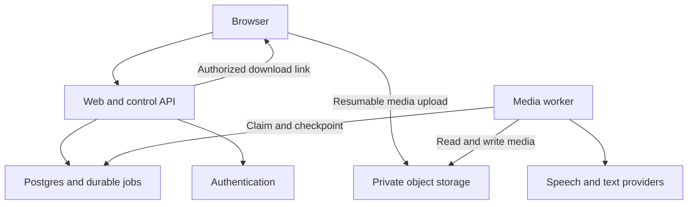

# Clipmax — MVP Product and Engineering Specification

Version 1.1 • 29 September 2026 • Owner: Umanor Wisdom Chizoba

Status: proposed implementation baseline, ready for technical prototyping. No application has been built or deployed by this document. Cost figures are planning assumptions, not vendor quotes. Budget and product-market fit remain unvalidated.

## 1. Product decision

Clipmax helps creators turn their own long-form spoken videos into short, editable clips accompanied by original voice-over scripts and prompts for an external voice-generation service. Clipmax does not generate voice audio in the MVP.

Initial audience: independent podcasters, educators, interview creators, and church media teams. Recruit five creators from one of these groups first; avoid trying to serve every niche simultaneously. The initial value proposition is time saved finding and preparing usable moments, not guaranteed virality.

Critical boundary: a voice-over prompt is a creative output, not proof of permission to reuse footage. The product must never present generated commentary as rights clearance. Require uploaders to confirm permission and provide a reporting/removal process before public launch. Obtain jurisdiction-specific review of public terms before commercial launch.

### MVP scope

| Included | Deferred |
|---|---|
| Responsive web application | Native Android/iOS applications |
| Verified account and private project dashboard | Organizations and shared workspaces |
| Direct, resumable upload | YouTube/TikTok downloads or arbitrary URL ingestion |
| English spoken-content transcription | Guaranteed Pidgin or multilingual support |
| Up to five selected clips | General action/sports/visual highlight detection |
| Editable timestamps and plain captions | Timeline editor, word animation, automatic face tracking |
| Original-ratio and padded vertical export | Automatic cinematic reframing |
| Voice-over script and external generation prompt | Voice synthesis, cloning, voice mixing |
| MP4, SRT, and text downloads | Auto-posting and social-account integrations |
| Usage limits, deletion, restricted operational dashboard | Subscription billing during initial private testing |

Do not build a generic CapCut replacement. The difficult hypothesis is whether the selected moments and scripts are useful enough for creators to return.

## 2. Goals and validation

Run a private pilot with 5–10 invited creators and at least 20 permissioned test videos. Include Nigerian English speakers; label Pidgin experimental until measured.

Proposed pilot gates, not measured outcomes:

- At least 70% of evaluated uploads produce one clip the creator would publish after minor edits.
- At least 60% of returned candidates receive a creator rating of useful.
- At least 50% median reduction in time to prepare a first clip versus each creator's recorded manual baseline.
- At least 95% completion for valid supported uploads in the controlled pilot; track first-attempt and eventual success separately.
- Every job records estimated and actual variable cost; no unexplained duplicate user debits.
- Zero successful cross-account access in authorization tests.
- Three of five interviewed creators express a concrete willingness to pay after using outputs. This is a signal, not revenue validation.

Measure first export, useful-candidate rate, trim edits, script rewrites, failed stages, processing latency, repeat weekly use, cost per input minute, and cost per downloaded clip. Avoid advertising a virality score; use an internal editorial score with a plain-language reason.

## 3. User journey and screens

1. Sign up, verify email, and accept applicable terms.
2. Create a project; choose a local video and confirm upload rights.
3. See limits and expected usage before uploading. Resume interrupted uploads.
4. Server probes the uploaded file and shows its authoritative duration and processing charge in credits/minutes.
5. Click Generate. Show queued, transcribing, selecting, writing, rendering, and completed states. Closing the browser does not stop processing.
6. Review up to five clip cards with title, reason selected, source timestamps, video preview, captions, script, and voice-generation prompt.
7. Adjust start/end, caption text, and export layout. Regenerate scripts explicitly when a trim changes context. Save revisions and rerender the affected clip only.
8. Download MP4, SRT, and script/prompt text independently. Clearly state that voice audio is not included.
9. Delete the project or view its expiry date.

Screens: landing page; authentication; project list; upload/setup; processing status; clip review/editor; usage/settings; minimal admin operations. Clip editor uses native video controls and timestamp inputs initially. Provide keyboard access, labelled controls, visible focus, adequate contrast, and responsive layouts.

Empty/error states: insufficient speech, unsupported media, oversized video, upload expired, no strong candidates, provider unavailable, exhausted quota, partial render failure, expired source, and deleted project. Never substitute fabricated clips for an empty result.

## 4. Functional requirements and acceptance criteria

| ID | Requirement | Acceptance criterion |
|---|---|---|
| AUTH-01 | Private accounts | User A cannot read, mutate, enqueue, or download User B's resources, including guessed IDs. |
| UP-01 | Resumable upload | A network interruption can resume the same permitted object without creating a duplicate project. |
| UP-02 | Verified media | Server checks actual bytes, duration, codec, dimensions, and audio; renamed non-video input is rejected. |
| JOB-01 | Durable processing | Closing the tab or restarting the worker does not lose a submitted job. |
| AI-01 | Grounded candidates | Each start/end derives from transcript timestamps; invalid or out-of-range ranges cannot reach rendering. |
| AI-02 | Honest selection | Return fewer than three candidates when fewer strong moments exist; explain insufficient speech. |
| TXT-01 | Per-clip writing | Each clip has an editable narration script and a separate generation prompt, tied to source evidence. |
| EDIT-01 | Revision safety | Changing trim/captions creates a new revision; stale renders cannot overwrite newer edits. |
| OUT-01 | Usable exports | Exported MP4 plays with synced source audio; SRT begins at clip-relative time zero. |
| COST-01 | Atomic limits | Concurrent requests cannot exceed reserved quota; duplicate submissions cannot double-charge. |
| DEL-01 | Complete deletion | Deletion blocks downloads immediately, cancels active work, and schedules removal of all derived assets. |
| OPS-01 | Recoverable failures | Retryable failures resume from a completed stage without retranscribing unnecessarily. |

### Initial configurable limits

Private beta: 2–30 minutes per source, 500 MB maximum, at most 1920×1080 or its portrait equivalent, up to 60 fps, MP4/MOV containers with explicitly supported video/audio codecs verified during the spike. Reject unsupported streams instead of attempting arbitrary conversion. Output H.264/AAC MP4 at up to 720p/30 fps initially, with aspect-preserving scale/pad; never upscale smaller inputs.

Target clips: 20–60 seconds; three by default, five maximum. One active pipeline per user and one concurrent render globally initially. Trial allowance: 60 verified input minutes per invited account and two user-requested rerenders per clip. These are product controls, not provider constraints. Validate all limits server-side.

## 5. Architecture and stack

Use a small TypeScript application with one separate media worker. Do not start with Kubernetes, several microservices, a vector database, or a mobile app.

| Layer | Baseline choice | Purpose and trade-off |
|---|---|---|
| Web and control API | Next.js, TypeScript, Tailwind, accessible component primitives | One codebase for UI and short authenticated API operations. Pin supported versions at implementation. |
| Database and ORM | Neon PostgreSQL + Prisma | Server-only relational access, versioned migrations, and explicit ownership checks. [S6] |
| Authentication | Better Auth + Prisma adapter | Database-backed sessions, verification and password reset; configure email delivery. [S7] |
| Transactional email | Brevo — proposed provider | Verification and password-reset messages; verify sender domain and current plan before launch. |
| Object storage | Private Cloudflare R2 buckets + AWS SDK for JavaScript v3 | S3-compatible private media access through scoped signed URLs; separate storage credentials. [S4] |
| Upload client | S3 multipart browser uploader | Persist multipart sessions and resume completed parts; no tus service required. [S1] |
| Media worker | Node.js container with FFmpeg/ffprobe | Durable background processing on a CPU host; benchmark 2 vCPU/4 GB as a starting candidate, not a capacity promise. |
| Queue | Postgres job table with leases | Avoid Redis for a low-volume pilot; short transactional claims, retries, fencing, and a reaper are mandatory. |
| Speech API | Timestamp-capable transcription provider behind an adapter | OpenAI transcription is a candidate; choose a model that actually exposes required timestamp granularity. [S2] |
| Text AI | One structured-output model behind an adapter | Candidate ranking and script drafting; select through the evaluation set and measured cost. |
| Hosting | Web host for Next.js; separate always-running worker host | Vercel is a candidate for the web tier. Do not place the media pipeline in request handlers. [S3] |
| Quality/operations | Vitest, Playwright, SQL authorization tests, structured logs | Add an error monitoring service if needed; redact source content. |

Suggested repository:

```text
apps/web/             UI and control API
apps/worker/          pipeline stages and scheduler
packages/contracts/  schemas, shared types, error codes
packages/ai/         provider adapters and versioned prompts
packages/media/      validated render specifications
prisma/schema.prisma models, including generated auth models
prisma/migrations/   reviewed schema, constraints, indexes, queue SQL
packages/db/         server-only Prisma client and authorized data access
tests/fixtures/      small permissioned media samples
docs/                decisions, runbooks, evaluation records
```



The API enqueues work and responds with HTTP 202. The browser polls authorized progress with backoff; realtime subscriptions are optional. Database stores metadata, not binary video. Authentication determines identity; ownership is independently checked for every resource. The backend authorizes R2 signatures; the browser never receives database or R2 credentials. [S4]

### Authentication, deployment, and connection requirements

Use Better Auth's supported session and password handling rather than custom cryptography. Require email verification before processing, implement password-reset delivery, rate-limit auth and email actions, configure trusted origins and secure cookies, and revoke sessions on account suspension. Admin authorization comes from trusted server-controlled data. A route guard or middleware redirect alone is not API authorization.

Configure Brevo with a verified sending domain, delivery/error handling, and separate staging credentials. Test verification, reset, expired/reused tokens, login, logout, and session revocation end to end. Auth tables, credentials, and tokens must never be returned by generic application endpoints.

Use a bounded Prisma connection pool for web and worker processes. Neon pooled connections serve ordinary short queries and transactions; use a separately configured migration connection according to the pinned Prisma/Neon versions. Queue claims must execute on one transaction-capable connection. Do not use session-scoped locks or LISTEN/NOTIFY through transaction pooling. Poll with idle backoff; persistent queue polling may prevent scale-to-zero, so include active database compute in the cost model. Do not assume the free tier covers an always-running worker.

R2 CORS must permit the application's origins and required upload methods/headers and expose ETag. CORS does not authorize users. Disable public bucket access, scope R2 API tokens, and authorize multipart initiation, part signing, resume, completion, abort, and download separately. Server-side raw SQL for queue claims must be parameterized.

Required server configuration categories: DATABASE_URL; migration database URL where needed; BETTER_AUTH_SECRET and canonical app URL; R2 endpoint/account identifier, bucket and scoped access credentials; BREVO_API_KEY and sender address; speech/text provider settings. Keep secrets out of NEXT_PUBLIC variables. Maintain placeholders in .env.example and validate configuration at startup.

This replaces one managed backend bundle with explicit components. It increases integration and operational responsibility; it is not a claim of lower total cost. Reprice the provisional budget after benchmarking.

## 6. Database structure

Use UUID primary keys for application tables and UTC timestamps. Generate Better Auth's user/session/account/verification models with its pinned tooling, review the Prisma schema, and retain its supported ID types; user foreign keys must match those IDs. Store money as integer micros with explicit currency; store durations as integer milliseconds. The following is a schema specification, not a ready-to-run SQL migration.

| Table | Important fields and relationships |
|---|---|
| Better Auth models | Generated user, session, account, verification models; library-owned credential/session handling, unique email, expiry and token constraints |
| profiles | user_id → Better Auth user.id (matching ID type), display_name, account_status, created_at |
| projects | id, owner_id, title, status, language, rights_attested_at, terms_version, expires_at, deleted_at |
| assets | id, project_id, kind, object_key, size_bytes, checksum, duration_ms, width, height, codec, status, expires_at |
| upload_sessions | id, project_id, source_asset_id, r2_upload_id, object_key, allowed_bytes, part_size, expected_parts, expires_at, completed_at; one active source upload per project |
| upload_parts | upload_session_id, part_number, etag, size_bytes; unique (upload_session_id, part_number); reconcile against R2 ListParts |
| transcripts | id, project_id, source_asset_id, provider, model, language, revision, status, prompt_version |
| transcript_segments | id, transcript_id, ordinal, start_ms, end_ms, text, optional words_json |
| jobs | id, project_id, type, stage, status, payload_version, dedupe_key, attempt, max_attempts, available_at, lease_until, lease_token, heartbeat_at, error_code, cancel_requested_at |
| job_steps | id, job_id, stage, input_hash, output_ref, status, provider_request_id, attempt, estimated_cost_micros, actual_cost_micros |
| clips | id, project_id, active_revision, status, editorial_score, selection_reason |
| clip_revisions | id, clip_id, revision, start_ms, end_ms, title, layout, captions_json, script, voice_prompt, evidence_segment_ids, script_status, render_status |
| renders | id, clip_revision_id, render_spec_hash, job_id, output_asset_id, status |
| quota_accounts | owner_id, period_start, period_end, allowance_ms, reserved_ms, consumed_ms |
| quota_reservations | id, owner_id, job_id, amount_ms, state; unique job_id |
| usage_events | id, owner_id, job_id, event_type, units, unit_type, cost_micros, currency, dedupe_key |
| feedback | id, owner_id, clip_id, useful, rating, optional reason |
| audit_events | id, actor_id, action, target_type, target_id, redacted_metadata, created_at |

Constraints and indexes:

- Unique (transcript_id, ordinal), (clip_id, revision), renders.render_spec_hash scoped to revision, jobs.dedupe_key, usage_events.dedupe_key, quota_reservations.job_id.
- Check end_ms > start_ms and start_ms >= 0. Source-duration checks require transactional application logic or a trigger because they involve another row.
- Index projects(owner_id, created_at DESC), assets(project_id), clips(project_id), transcript_segments(transcript_id, ordinal), jobs(status, available_at), and jobs(lease_until) for active jobs.
- Parent-child foreign keys must prevent linking another owner's assets to a project. Derive ownership through the parent, or enforce matching ownership through composite constraints; do not trust copied owner IDs from clients.
- All database access is server-only through Prisma or narrowly scoped parameterized SQL. Centralize ownership-filtered reads and mutations in packages/db; never trust owner_id from request bodies. There is no browser-facing database API. Separate schema-owner/migration credentials from restricted runtime roles; revoke unnecessary schema/function grants.
- Workers must validate job/project/asset relationships. PostgreSQL RLS is optional defense in depth, not assumed automatic tenant isolation. If introduced, define and test transaction-local identity with a non-owner runtime role; do not rely on persistent session variables through a transaction pooler.

Do not use a mutable user balance as the only accounting record. Keep append-only usage events plus atomic reservations; this makes retries and reconciliation explainable.

## 7. Processing workflow and reliability

State sequence: uploaded → validating → queued → transcribing → selecting → writing → rendering → completed. Additional states: partially_completed, failed, cancel_requested, cancelled, deleting, deleted. Jobs also have retry_wait. Progress describes stages, not invented percentages.

1. **Upload:** create an authorized R2 multipart session with a server-generated object key. Persist upload ID, part size/count, and expiry. Sign only permitted part numbers for that session, upload parts directly to R2, and reconcile uploaded parts via server-side ListParts before completing. Verify part sizes and total bytes before completion, then verify the final object with HeadObject. Reject and abort oversized or expired sessions; configure cleanup for abandoned multipart uploads. Do not claim that a presigned URL alone enforces the application's total byte quota. A browser reload may require the user to reselect the same file; verify its fingerprint and size before resuming.
2. **Probe:** run ffprobe under resource/time limits. Check stream metadata, duration, dimensions, and supported codecs. Reject invalid files and schedule their deletion.
3. **Reserve:** after authoritative probing, atomically reserve rounded-up input minutes and insert the deduplicated pipeline job. Insufficient allowance fails before calling paid providers.
4. **Extract:** produce compact speech audio in a restricted temp directory. Split to the selected provider's supported request size/duration; record absolute offsets and overlap boundaries.
5. **Transcribe:** request timestamped segments; persist stage outputs, provider usage, and model version. Reconcile overlapping chunks; maintain monotonic source-relative timestamps. If timestamps are unavailable, switch to a verified compatible model or fail explicitly; do not fabricate them.
6. **Select:** analyze transcript windows, score candidate segments, and globally deduplicate overlapping candidates. Snap boundaries to real speech/sentence timestamps and validate 20–60 second duration and source bounds.
7. **Write:** generate each script from its selected evidence. Label uncertain words and avoid unsupported visual claims. Save script and separate voice prompt before rendering.
8. **Render:** generate MP4 and SRT from a validated render specification. Clip-relative captions subtract start_ms, discard out-of-range words, and clamp boundary cues. Escape text as subtitle data, not shell commands. Padded vertical mode preserves the full frame.
9. **Publish results:** upload to private storage, verify playable streams/duration, then atomically attach assets only if the lease and project generation are current. Partial success remains downloadable.
10. **Settle:** debit user allowance once on completed or partially completed output with at least one playable clip; release it on total system failure. Log actual provider/compute spending even when users are refunded. Track draft script failures per clip and permit targeted retries.
11. **Clean up:** delete temporary data in finally handlers; run periodic orphan and retention cleanup to handle crashes.

### Queue contract

Claim eligible jobs in a short transaction using row locking and SKIP LOCKED; commit before any external call. PostgreSQL documents this pattern as useful for queue-like consumers. [S5] A claim creates a fresh fencing token, a lease, and an attempt number. Initial proposed heartbeat: 15 seconds; lease: 90 seconds. Tune against measured stage behavior.

Workers renew leases and complete steps only when their token still matches. A reaper returns expired leases to retry_wait. A stale worker cannot publish or charge; its unreferenced uploads are cleaned later. Maintain a unique render-spec/input hash so repeated execution reuses existing completed work.

Use at-least-once processing; do not claim exactly-once external API execution. A provider may have completed a request before a network timeout. Persist request IDs and reconcile status where supported; cap ambiguous retries and record potential duplicate provider costs.

Retry transient network/429/5xx errors with jitter and bounded exponential backoff, respecting Retry-After; at most three total attempts per stage initially. Invalid media and authorization failures do not retry. A circuit breaker pauses new provider work after repeated failures. Cancellation stops subprocesses and future stages; already incurred provider costs remain operational expenses.

## 8. AI design

Transcript-first selection is an intentional limitation. It cannot establish visual action, facial expression, or events not mentioned in the audio. Do not advertise full video understanding. Add selective frame analysis only after users demonstrate that speech-only selection is insufficient and costs are understood.

### Candidate scoring rubric

Weight standalone clarity 30%, useful insight/payoff 25%, opening strength 20%, coherent ending 15%, and distinctness 10%. Scores are model judgments, not probabilities of success. Require evidence segment IDs for every candidate and reject duplicate or heavily overlapping suggestions (initial overlap threshold: over 50% of the shorter candidate).

Candidate output contract:

```json
{
  "candidates": [{
    "start_segment_id": "segment-id",
    "end_segment_id": "segment-id",
    "title": "Short editorial title",
    "reason": "Why this moment stands alone",
    "score": 82,
    "uncertainties": []
  }]
}
```

Resolve IDs to real timestamps in code. Never allow the model to provide executable FFmpeg commands, storage paths, SQL, or URLs.

### Voice-over deliverable

Each clip includes: hook, narration script, closing line where appropriate, intended tone, language, pacing, pronunciation notes, approximate word count, source evidence, and a copyable generation prompt. Default target: 130–150 words per minute; calculate target length from the clip duration and allow space for pauses. Timing remains approximate until the user generates audio externally.

Example voice prompt template: “Read the following original commentary in a clear, conversational voice, approximately {duration} seconds, at {pace} words per minute. Use natural pauses. Do not impersonate a named person. Read only the script: {script}.”

No invented quotes, unverified statistics, or claim that the original speaker said the generated narration. Distinguish source captions from commentary. User edits to timestamps mark existing script as potentially stale; do not silently regenerate paid content.

### Prompt and evaluation controls

- Treat transcripts and metadata as untrusted data; instructions embedded in a video never override system rules.
- Validate JSON against a strict schema; permit one bounded repair attempt before a transparent failure.
- Version prompts, model configuration, schemas, and render presets.
- Compare models on the same 20-video test set; measure usefulness, timing errors, factual grounding, latency, and cost.
- Include quiet audio, strong accents, code switching, repeated segments, no speech, incomplete sentences, and prompt-injection text.
- Use human review for launch quality; do not pretend an AI self-score is objective validation.

## 9. API contracts

All application endpoints require verified authentication except narrowly defined public pages and the Better Auth authentication routes. Auth routes remain protected by library origin checks, rate limits, and token validation. Return a consistent error shape: {code, message, request_id, retryable}. UUIDs are identifiers, not authorization. Paginate lists with cursors. Validate bodies and bound their size.

| Method and path | Contract |
|---|---|
| GET/POST /api/auth/[...all] | Better Auth handler for signup, login, logout, session, verification and reset flows; use library clients/contracts |
| POST /api/projects | title, language, rights confirmation → project ID |
| GET /api/projects?cursor=… | Owned project summaries and next cursor |
| POST /api/projects/:id/uploads | file metadata → scoped upload session and upload instructions |
| POST /api/uploads/:id/parts/sign | Validate ownership/session/part numbers → short-lived signed UploadPart URLs |
| GET /api/uploads/:id/parts | Authorize and reconcile R2 ListParts → uploaded part numbers/ETags |
| POST /api/uploads/:id/complete | Verify parts, complete multipart upload, verify object and enqueue probe → 202, probe job ID |
| DELETE /api/uploads/:id | Authorize and abort incomplete multipart upload |
| GET /api/projects/:id | Authorized status, verified duration, quota estimate, clips |
| POST /api/projects/:id/process | Idempotency-Key plus clip count/layout → atomic reservation and 202 job ID |
| GET /api/jobs/:id | Sanitized stage, retry status, outputs; never internal provider secrets |
| POST /api/jobs/:id/cancel | Cooperative cancellation request |
| PATCH /api/clips/:id | Expected revision plus trim/caption/script edits → new revision; 409 on conflict |
| POST /api/clips/:id/render | Revision plus Idempotency-Key → bounded render job |
| POST /api/clips/:id/script | Explicit script regeneration for a revision; quota/rate limited |
| POST /api/assets/:id/download | Ownership/expiry check → short-lived signed URL |
| POST /api/clips/:id/feedback | Useful flag/rating and bounded text |
| DELETE /api/projects/:id | Tombstone, cancel, queue asset deletion → 202 |
| GET /api/usage | Allowance, reserved, consumed, reset period |

Idempotency keys are scoped by user and endpoint with a request-body hash. Same key/same payload returns the original result; same key/different payload returns 409. Store the result for at least 24 hours. Use 401, 404 for inaccessible resources, 409 for state conflicts, 413 for oversize, 422 for unsupported input, and 429 for rate/quota limits with clear codes.

External services at launch: Neon PostgreSQL connection (not a browser API), Cloudflare R2 S3 API, Brevo email API, one transcription API, and one structured text-generation API. Better Auth is an application library with its own routes, not an additional hosted auth service. Prisma is the ORM and migration layer, not another database. Payments, social APIs, stock footage, and voice-generation APIs are not required for the pilot.

## 10. Security, privacy, and abuse controls

| Risk | Required control |
|---|---|
| Cross-account access | Centralized ownership-filtered server queries/mutations, private buckets, signed-download expiry, two-account negative tests |
| Media exploit/resource exhaustion | Patched non-root FFmpeg container, CPU/RAM/disk/time caps, bounded input streams, per-job temp directories |
| Command injection | Spawn argument arrays without a shell; fixed filters; validated numeric parameters; safe subtitle serialization |
| Unexpected network access | Parse local files only; restrict FFmpeg protocols and worker egress; no URL ingestion in MVP |
| AI spending abuse | Verified users, invitation gate, atomic reservations, rate limits, global spend admission control |
| Prompt injection | No tools in selection/writing calls; transcript treated as data; schema/range validation |
| Secret exposure | Server-only credentials, separate staging/production secrets, rotation, no credentials in frontend bundles |
| Session attacks | Secure session configuration, origin/CSRF protection for cookie-authenticated mutations, restrictive CORS |
| Malicious captions/titles | Render as text; no raw HTML; sanitize exports and filenames |
| Sensitive footage leakage | No raw transcript/video in logs; minimal provider payload; disclose external processing |
| Unauthorized uploads | Rights attestation, clear acceptable-use rules, abuse contact, removal and suspension workflow |
| Admin abuse | Server-controlled admin role, MFA where supported, narrow access, audited privileged actions |

Private pilot moderation can combine invite-only access, user reporting, and manual review. Transcript checks do not detect all prohibited visual content. Resolve visual abuse review and escalation before allowing unrestricted public uploads.

Proposed retention: sources and derived files expire after seven days, displayed before processing. Users can delete earlier. Revoke application access immediately on deletion; short-lived links may remain usable until expiry, so use five-minute download URLs. Complete live-storage deletion within 24 hours as an operational target. Disclose actual backup and provider retention once chosen; do not promise instantaneous erasure from third-party systems. Keep minimal pseudonymous cost/audit records only as needed under the final retention policy.

## 11. Budget and unit economics

No monthly amount was supplied. Use a provisional internal ceiling of US$50/month for a restricted pilot; this is a design assumption, not a quote or a claim that all chosen services fit it. If actual fixed costs exceed the ceiling, run a local technical prototype and delay hosted beta. Do not buy services before reviewing their current plan eligibility, regional availability, payment requirements, and full charges.

Planning allocation: up to $25 fixed web/database/storage baseline, $15 variable AI/compute allowance, and $10 contingency. These envelopes may require revision after provider selection. They exclude founder time, device costs, connectivity, taxes, payment fees, and a domain. No naira conversion is included because exchange rates change.

Per-job variable cost:

```text
speech minutes × transcription rate
+ input/output text tokens × their respective rates
+ worker runtime hours × compute rate
+ allocated storage GB-days × storage rate
+ upload/download transfer charges
+ retry overhead
```

Illustration only: if measured variable cost is $0.20 per 20-minute input, a $15 variable envelope supports 75 such jobs before extra contingency. At $0.80 it supports only 18 whole jobs. These are sensitivity examples, not estimates of actual provider pricing.

Store provider prices and model IDs as configuration with a reviewed date. Convert verified duration to credits using ceil(duration_ms / 60000). Reserve upper-bound internal spend before provider calls and reconcile actual usage afterward. Provider dashboard alerts alone are not a hard cap.

At 70% monthly budget usage alert the operator; at 90% stop admitting new jobs unless their reserved worst-case cost fits the remaining budget. Include active reservations, outstanding uncertain provider requests, and fixed expenses. Provide a manual kill switch. Never offer unlimited processing.

Only design paid plans after measuring real costs and willingness to pay. Price included minutes and rerenders so expected revenue covers all variable costs, retries, support, and fixed overhead. Add payment webhooks with signature verification and idempotency in a later phase.

## 12. Stability and scaling

Start with one worker and global render concurrency one. Limit local disk usage before downloading each source. A 500 MB input can generate much more temporary data; budget disk from measured worst cases rather than file size alone.

Collect queue age, active jobs, stage latency, provider failures, worker memory/disk, temp cleanup failures, deletion backlog, cost, and successful-download counts. Alert on worker heartbeat loss, sustained failed jobs, oldest queue age above the published expectation, and budget thresholds. Redact signed URLs and user text from logs.

Backup database according to the selected plan or an independent encrypted schedule; test restore before inviting users. Database backups do not by themselves guarantee object recovery. Decide whether the seven-day media can be recreated or needs separate backup, and document that choice. Initial targets: metadata RPO 24 hours and RTO one business day; these require verification, not marketing promises.

Scale when measurements justify it: add stateless workers when queue wait is excessive and budget permits; split transcription and rendering queues when they contend; adopt a dedicated queue service when operational complexity or database pressure becomes material. Move storage only after transfer/storage economics justify migration. GPU infrastructure is not a launch requirement.

Deploy using graceful worker shutdown: stop claims, finish or release leases safely, then replace the container. Use backward-compatible migrations and versioned job payloads. Roll back application releases without deleting migrations or user data.

## 13. Phased implementation plan

Indicative effort for one developer: 6–8 focused weeks, potentially longer around other work. These are estimates, not commitments. Move by exit gates.

| Phase | Work | Exit gate |
|---|---|---|
| 0 — Technical proof, 3–5 days | Process a permissioned 10–20 minute video locally: transcript → candidate ranges → three MP4s → scripts; record costs and runtime. | Real clips play correctly; creator judges at least one useful; no mock success. |
| 1 — Foundation, 3–5 days | Monorepo, Prisma migrations, Better Auth, server authorization, private R2 buckets, CI, environment validation. | Two-account authorization tests pass; reproducible setup. |
| 2 — Upload and jobs, 4–6 days | Resumable uploads, probe, reservations, durable queue, leases, cancellation, cleanup. | Network interruption, duplicate submission, and worker restart recover safely. |
| 3 — AI pipeline, 5–7 days | Chunking, timestamp alignment, ranking, script generation, schema validation, evaluation set. | Candidate quality gate and bounded spend verified. |
| 4 — Review and exports, 4–6 days | Clip cards, preview, timestamp editing, captions, revisions, padded export and downloads. | Export/caption timing tests pass; stale output cannot replace current revision. |
| 5 — Hardening, 4–6 days | Retention, admin controls, failure recovery, observability, backup restore, accessibility. | Launch checklist passes on staging. |
| 6 — Pilot, 1–2 calendar weeks | Invite creators gradually, observe sessions, gather ratings/costs and fix blockers. | Evidence supports continuation, scope change, or stopping. |

First working session: obtain one permissioned spoken video; define transcript and candidate schemas; create the local FFmpeg worker spike; manually inspect three cuts. Avoid spending the first week on landing-page animation.

## 14. Verification and launch gates

Required engineering tests:

- Units: timestamp conversion, caption offsets, schema validation, quota rounding, and overlap filtering.
- Database/integration: foreign ownership, server data-access authorization, atomic reservations, repeated idempotency keys, failed settlement, and deletion races.
- Worker fault injection: terminate after transcription, after provider success, and after asset upload; verify recovery and bounded duplicate spending.
- Media fixtures: rotated portrait video, variable frame rate, unsupported codec, corrupted file, silence, long pauses, large dimensions, and subtitle metacharacters.
- End-to-end: sign in → resume upload → generate → edit → export → delete using real small fixtures. Keep mocks limited to isolated automated provider tests.
- Load: submit ten pilot jobs concurrently; verify global concurrency, fairness, queue progress, and disk safety. This does not prove large-scale capacity.
- AI evaluation: human ratings plus timing/factual grounding checks on the fixed permissioned dataset.

Before private beta: real processing passes; owner isolation passes; secrets absent from bundles; spend caps work; expired leases recover; cancellation/deletion are tested; retention job runs; operational contact is visible; database restore rehearsed; known language limitations disclosed.

Before public or paid launch: validate demand and cost, review current provider plans and terms, implement appropriate billing/reconciliation, settle privacy/rights/reporting workflows, and expand abuse handling. No technical document can guarantee a mistake-free launch.

## 15. AI coding master prompt

Use this with a coding assistant in the actual project repository:

> You are the senior engineer implementing Clipmax according to this specification. First inspect the repository, existing instructions, dependencies, and environment; do not assume files or services exist. Keep a TypeScript Next.js control plane, Better Auth with Prisma, Neon PostgreSQL, and private Cloudflare R2 storage, and a separate Node/FFmpeg worker. Build Phase 0 first with one permissioned local video. Deliver working timestamped transcription, validated clip selections, playable MP4 cuts, and grounded voice-over scripts/prompts. Do not build voice generation, URL downloading, billing, native apps, or a full editor.
>
> Use current official documentation for provider contracts and choose a transcription model with verified timestamp support. Pin dependencies. Treat model outputs and source transcripts as untrusted input. Validate schemas, source ranges, and media metadata in code. Never execute model-generated commands. Keep credentials server-only and obtain configuration through environment variables. Do not fabricate results when credentials or services are unavailable; explain the blocker and keep mocks visibly limited to tests.
>
> For subsequent phases, implement Prisma migrations, centralized server authorization, durable jobs with leases/fencing, atomic quota reservations, idempotent stage outputs, retry limits, per-clip revisions, private downloads, and deletion. Use direct resumable uploads and background processing; do not send video through web API handlers. Follow the exit gates in order. After each phase, report implemented behavior, commands/tests actually run, measured cost/runtime where available, and remaining risks. Do not claim production readiness without the launch gates passing. Ask only about consequential missing decisions; choose conservative reversible defaults for routine implementation details.

## 16. Open decisions and defaults

| Decision | Current default | Revisit when |
|---|---|---|
| Monthly budget | Provisional $50 ceiling | Founder provides actual budget; provider quote reviewed |
| First customer segment | Spoken-content creators; recruit one niche | Five interviews completed |
| Language | English; Nigerian English evaluated | Pidgin/code-switching accuracy is measured |
| Speech/text model | Provider adapters; model chosen via benchmark | Phase 0 produces quality/cost results |
| Worker host and size | Separate CPU container; benchmark small instance | Actual runtime and disk use known |
| Commercial model | Invite-only pilot with usage allowance | Repeat usage and unit economics established |
| Retention | Seven days | User needs and real storage expense measured |

## 17. Official technical references

Original references reviewed 28 September 2026; replacement stack references reviewed 29 September 2026. These support platform capabilities; product limits, targets, queue design, budget envelopes, and implementation choices above are Clipmax proposals. Recheck exact SDK contracts and plan pricing before implementation.

- [S1: Cloudflare R2 uploads and multipart selection](https://developers.cloudflare.com/r2/objects/upload-objects/)
- [S2: OpenAI file transcription and timestamp options](https://developers.openai.com/api/docs/guides/speech-to-text)
- [S3: Vercel function limits](https://vercel.com/docs/functions/limitations)
- [S4: R2 presigned URLs](https://developers.cloudflare.com/r2/api/s3/presigned-urls/) and [CORS](https://developers.cloudflare.com/r2/buckets/cors/)
- [S6: Neon connection pooling](https://neon.com/docs/connect/connection-pooling)
- [S7: Better Auth, Prisma and Next.js integration](https://www.prisma.io/docs/guides/authentication/better-auth/nextjs)
- [S8: Better Auth email flows](https://better-auth.com/docs/authentication/email-password)
- [S9: Brevo Node.js integration](https://developers.brevo.com/docs/send-a-transactional-email)
- [S5: PostgreSQL SELECT and SKIP LOCKED](https://www.postgresql.org/docs/current/sql-select.html)
